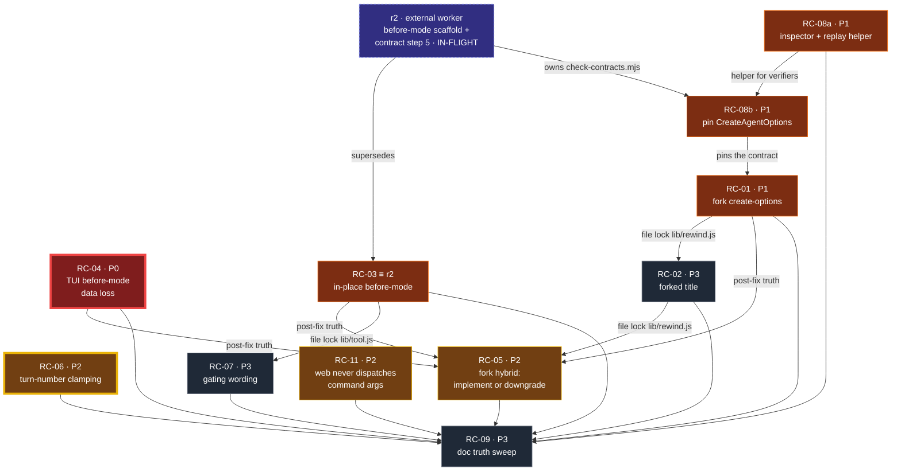
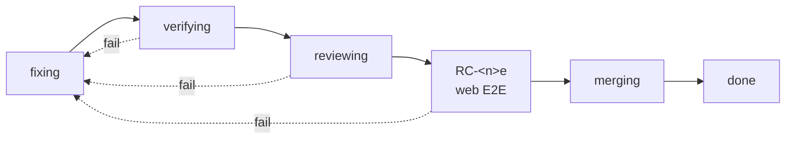

# Rewind-compact — task dependency graph

Living plan for the v1 limitation fixes found in the [README](../README.md) audit.
One node = one unit of work that a single agent can complete. Nothing here is
"done" by self-report: every node passes through fix → verify → review with three
different agents, each on its own branch in its own worktree.

## Reconciliation with the project graph

This file is the **limitation-remediation** subgraph. The project-level delivery
graph is [`docs/task_dependencies.mmd`](task_dependencies.mmd).

- Its in-flight node **r2** ("Fix before-mode scaffold placement + contract check")
  **supersedes RC-03** here. r2 currently owns `lib/tool.js` and
  `scripts/check-contracts.mjs` as **uncommitted working-tree changes**.
- Therefore the main tree `/mnt/Workspace/Workspace/dsh-rewind-compact` is
  **reserved for the external worker**. No node in this graph writes there.
- RC-03 becomes a *verification* job (review r2's change), not a fix job.
- RC-08 is blocked on r2 for its `check-contracts.mjs` half; its new-file half is
  free (see the RC-08 card).

## Decisions log

| id | question | resolution |
|---|---|---|
| **D1** | E2E gate scope | **B — risk-tiered.** Web E2E *where applicable*; the TUI rig is **human-gated** (never an agent task); an environmental E2E failure degrades to `npm run check` + boot smoke with the gap recorded. B(i) yes — RC-08a still gets a browser smoke. |
| **D2** | RC-08a: offline probe or live harness? | **A + (i)+(iii).** Offline tooling only (`scripts/inspect-fork.mjs` + a tail-replay helper); the pin derives the allowed option keys from the installed harness's `CreateAgentOptions` declaration **and** names the five concrete facts in its failure messages. No live capture — the tier-1 E2E rigs already boot. |
| **D3** | Two graphs: merge or keep separate, and commit? | **A.** Keep both — `TASK-GRAPH.md` is the remediation subgraph, `task_dependencies.mmd` the project graph — cross-linked. `TASK-GRAPH.md` is committed **path-scoped** (`git add docs/TASK-GRAPH.md`) so r2's uncommitted files are never staged. The reverse link into the `.mmd` waits until r2 lands, since editing it now would mix with r2's uncommitted edits. |
| **D4** | How to verify r2 while it is uncommitted? | **A.** r2 commits first; then **RC-03v** verifies that commit in its own worktree, exactly like every other node. No verifying a half-finished working tree. |

## Node schema

| field | meaning |
|---|---|
| `id` | `RC-<n>`, stable |
| `priority` | `P0` correctness/data loss · `P1` primary-surface correctness · `P2` claim/design · `P3` polish |
| `status` | `blocked` → `ready` → `fixing` → `verifying` → `reviewing` → **`e2e`** → `merging` → `done` (a failed phase returns to `fixing`) |
| `e2e` | the mandatory rig task (`RC-<n>e`); the node's branch may not merge until it passes |
| `fixer` | exactly one agent; sole writer of the node's `files` |
| `verifier` | a different agent, started only after the fixer's handoff lands |
| `reviewer` | a third agent, started only after verification passes |
| `branch` / `worktree` | where the node's work physically lives |
| `depends_on` | node ids that must be `done` before this node is `ready` |
| `files` | exclusive write set; a file has at most one active node |
| `acceptance` / `verification` / `review` | the three phase contracts |

## Agent contract

1. **One branch + one worktree per node.** Every agent works in
   `/mnt/Workspace/Workspace/dsh-rewind-compact.worktrees/<id>` on branch
   `rc/<id>-<slug>`. No agent writes to the main tree; that tree belongs to the
   external r2 worker.
2. **Branch lineage follows the DAG.** A node's branch is cut from `HEAD` when it
   has no dependencies, and from its prerequisite's branch when it does (so the
   dependency's effect is present). A verifier gets its own worktree on
   `rc/<id>-verify` cut from the fixer's branch — it sees the fix and cannot
   disturb the fixer's tree.
3. **One writer per file** *within* a node's worktree. Two nodes touching the same
   file are serialized by a dependency edge even when logically independent.
4. **Fixer commits before reporting.** Non-negotiable: an uncommitted tree cannot
   be verified. The handoff block records branch name + commit sha.
5. **Handoff on disk, not in context.** Subagents share no conversation. The fixer
   appends a `### RC-<n> handoff` block: files, branch, commit, exact repro
   command, observed before/after. Verifier and reviewer prompts quote it verbatim.
6. **The verifier never reads the fixer's transcript** and does not merely re-run
   the fixer's own test. It re-derives the failure independently, then reproduces
   the fixed behaviour from the branch (on-disk artifact, fresh profile).
7. **A regression test ships with the fix** — committed on the node's branch.
8. **Docs trail behaviour.** `RC-09` reconciles prose with behaviour and runs last.
9. Harness anchors: installed `dsh` 0.1.5-rc.1 launcher / harness packages
   0.1.5-rc.2, matching `docs/HARNESS-CONTRACTS.md`. Re-verify anchors before
   trusting a node's root cause after an upgrade.
10. **Every node ends at an E2E task.** `RC-<n>e` runs the real rig against that
    node's branch and commits evidence to `docs/e2e/RC-<n>.md` on `rc/<n>-e2e`. It
    is owned by an agent distinct from the fixer, verifier and reviewer.
11. **No branch merges without its E2E pass.** A node reaches `merging` only after
    its `-e2e` task is `done`. This is a gate, not a suggestion.
12. **The web rig is single-tenant.** All web E2E tasks share one profile
    (`web-rewind-test`) and one port (8124), so they run one at a time — queued,
    never in parallel.
13. **Worktrees have no local `node_modules`.** Peer packages
    (`@deepseek-ai/dsh-session`, `dsh-llm`, …) resolve only from the profiles-level
    hoist (`$DSH_HOME/profiles/node_modules`, TESTING.md:163-168). Any test importing a
    module that reaches those peers (`lib/rewind.js`, `lib/errors.js`) needs an explicit
    resolution fallback: RC-11's test registers a `node:module` resolve hook that
    re-anchors an unresolvable bare specifier there, using the real packages and failing
    loudly when they are absent. RC-01, RC-02 and RC-05 all touch `lib/rewind.js`, so
    expect the same need; the RC-11 reviewer decides whether to extract it into one
    shared helper.

**Caveat on lineage:** the rc-04 / rc-06 worktrees were cut from `3c1ad89` (the
last commit), which does **not** contain r2's uncommitted `lib/tool.js` work. Any
node merging those branches must rebase onto whatever r2 lands as.

## File ownership map

| file | nodes (serialized) |
|---|---|
| `lib/rewind.js` | RC-01 → RC-02 (→ any RC-10 spawned by RC-05) |
| `lib/tool.js` | **r2 (external, uncommitted)** → RC-07 |
| `lib/tui-rewind.js` | RC-04 |
| `lib/events.js` | RC-06 |
| `scripts/check-contracts.mjs` | **r2 (external)** → RC-08b |
| `tests/` (new files) | any node (no conflict — new paths per node) |
| `SPEC.md` §R5, `README.md` hybrid claim | RC-05 |
| `README.md` bullet-4 line | RC-02, only on its doc-only branch |
| every remaining doc paragraph | RC-09 (runs last) |

## Backlog — priority order

| id | P | title | files | depends_on | status |
|---|---|---|---|---|---|
| RC-04 | P0 | TUI "compact before" drops user turns and never compacts the prefix | `lib/tui-rewind.js` | — | **e2e** — f1 approved (`f501c29` + `9c7b054`, review `cb085fc`); web half dispatched, TUI half human-gated |
| RC-04h | P3 | Compose from the child's folded surface, not the raw log; make tail replay child-aware | `lib/tui-rewind.js` | RC-04 | proposed (reviewer: wider than idempotency) |
| RC-04i | P3 | Harness-version surface compat: 0.2.0 adds `developer/message` to the surface, `lib/events.js` `SURFACE_TYPES` omits it | `lib/events.js`, `tests/` | RC-04 | proposed |
| RC-04j | P2 | Contract probe is blind to the whole RC-04 defect class (surface-replace validity) | `scripts/check-contracts.mjs` | r2 (external) | proposed |
| RC-04k | P3 | Docs: `AGENTS.md:19`/`:38`, the inclusive-end note, and the shallow-clone-unsafe `git show` | docs, `tests/` | RC-04 | proposed |
| RC-06 | P2 | Out-of-range turn numbers silently clamp to the newest turn | `lib/events.js` | — | **merging** — fix `df63714`, verify `afd70df`, review `6191c63`, e2e `656b389` PASSED |
| RC-11 | P2 | `/rewind-compact <turn> [after\|before]` args are never dispatched by the web client | `lib/command.js` | — | verifying (fix `3c70746`) |
| RC-06h | P3 | Hardening: accept only canonical decimal integers as a rewind point | `lib/events.js` | RC-06 | proposed (reviewer judged it out of scope for RC-06) |
| RC-08a | P1 | Fork-artifact inspector + tail-replay assertion helper (offline only, per D2) | `scripts/inspect-fork.mjs`, `scripts/replay-check.mjs`, `tests/` | — | verifying (fix `b1d35fa`) |
| RC-08b | P1 | Pin `CreateAgentOptions`: harness-declaration subset **plus** named fact assertions (per D2) | `scripts/check-contracts.mjs` | r2 (external) | blocked |
| RC-01 | P1 | Fork create-options use the TUI adapter's input names, not the real contract | `lib/rewind.js` | RC-08b | blocked — **before-state measured** (see RC-01 card) |
| RC-03 | P1 | In-place before-mode: scaffold outside the range, false `hybrid: true` | `lib/tool.js` | — | superseded by external r2 (fix uncommitted, unreviewed) |
| RC-03v | P1 | Verify r2's committed before-mode change (`f6` re-check included) | `lib/tool.js` | r2 (external) | blocked until r2 commits |
| RC-05 | P2 | Fork summaries are never hybrid: implement child-side summarization or downgrade the claim | `SPEC.md` §R5, `README.md` | RC-01, RC-02, RC-03, RC-04 | blocked |
| RC-02 | P3 | Forked-session title is not a create option and is never applied | `lib/rewind.js` (docs on the doc-only branch) | RC-01 | blocked |
| RC-07 | P3 | Gating error says "requires approval"; it is a presence check and root-agent-only | `lib/tool.js` | RC-03 | blocked |
| RC-09 | P3 | Documentation truth sweep (README bullets 4–6, seam text, `HARNESS-CONTRACTS` recipe, `AGENTS.md` boundaryForPoint gotcha) | all remaining docs | RC-05, RC-06, RC-07 | blocked |

### Coverage map (nothing from the audit is dropped)

| audit finding / README bullet | node |
|---|---|
| Bullet 1 — no file revert (intentional, R10) | no action |
| Bullet 2 — no compaction service → no-op (`applied:false`) | no action (correct); revisited by RC-03, RC-05 |
| Bullet 3 — headless rewind fails closed | no action (correct); wording in RC-07 |
| Bullet 4 — forked title never applied | RC-02 |
| Bullet 5 — `_no-cwd` bucket | RC-01 |
| Bullet 6 — "verified end-to-end" listed as a limitation | RC-09 |
| Undocumented: unseeded child + lost lineage | RC-01 |
| Undocumented: model/preset not inherited | RC-01 |
| Undocumented: fork summaries never hybrid (R5) | RC-05 |
| Undocumented: before-mode in-place false `hybrid:true` + stray message | RC-03 (external r2) |
| Undocumented: TUI before-mode data loss | RC-04 |
| Undocumented: turn numbers silently clamp | RC-06 |
| Undocumented: the web client never dispatches command arguments, so the documented `/rewind-compact 3 after` fast path is unreachable in web | RC-11 |
| Undocumented: approval wording / root-agent restriction | RC-07 |
| Undocumented: no test exercises the fork/tool/TUI paths | RC-08 |

---

## Dependency graph



### Reading the graph

Two edge kinds, and the distinction matters for scheduling:

- **Logical** — the target needs the source's outcome (`RC-08b → RC-01` supplies the
  contract probe; `RC-01/02/03/04 → RC-05` supplies post-fix truth).
- **File lock** — no design coupling; the edge keeps "one writer per file" true
  (`RC-01 → RC-02` on `lib/rewind.js`, `RC-03 → RC-07` on `lib/tool.js`).

Scheduling facts:

- **RC-06** is verified (`afd70df`), reviewed (`6191c63`, approve-with-followups), and
  its E2E gate is running on `rc/06-e2e`.
- **RC-04** was verified (`c4b7b4d`) then **rejected** in review (`7a2e767`); the
  blocking fix landed as `f501c29` on `rc/04-f1` and is now independently verifying on
  `rc/04-f1-verify`.
- **Ready, no dependency:** RC-08a (new files only, so it does not contend with r2's
  `check-contracts.mjs`).
- **Blocked on the external r2:** RC-08b → RC-01 → RC-02/RC-05, and RC-03 → RC-07.
  The critical path is partly outside this graph's control until r2 lands.
- **Critical path:** `r2 → RC-08b → RC-01 → RC-02 → RC-05 → RC-09`.
- **Fan-out risk:** RC-01 feeds three nodes; a bad fix there is the most expensive
  mistake in the graph.
- **No cycles.** Every node is reachable from a ready root or from r2.
- **Conditional node:** if RC-05 chooses "implement" over "downgrade the claim", it
  spawns **RC-10** (child-side summarization; `lib/rewind.js`, `lib/tui-rewind.js`)
  gated behind RC-02 and RC-04.

---

## E2E merge gate

**Rule: no branch merges until its `-e2e` task passes.** A node reaches `merging`
only when its E2E task is `done` with evidence committed on `rc/<n>-e2e`.



### Per-node E2E tasks

| node | task | rig | branch | status |
|---|---|---|---|---|
| RC-04 | RC-04e | web smoke (automated) **+ TUI rig (human-gated)** | `rc/04-e2e` | blocked until RC-04-f1 is verified and re-reviewed |
| RC-06 | RC-06e | web, node driver: an out-of-range point must surface `unknown turn "99"` and fork nothing | `rc/06-e2e` | **DONE** `656b389` — PASSED (dispatch caveat below) |
| RC-08a | RC-08ae | web smoke — scripts-only change, proves the probe did not break the boot | `rc/08a-e2e` | blocked |
| RC-08b | RC-08be | web smoke | `rc/08b-e2e` | blocked |
| RC-01 | RC-01e | web fork + assert the child header carries `cwd`/`parentSession`/`isSeeded` | `rc/01-e2e` | blocked |
| RC-02 | RC-02e | web fork + the title appears in the session list | `rc/02-e2e` | blocked |
| RC-03 | r2's own E2E | web before-mode compact (external worker) | external | external |
| RC-05 | RC-05e | web + whichever hybrid/label behaviour the decision picks | `rc/05-e2e` | blocked |
| RC-07 | RC-07e | web + a headless run proving fail-closed | `rc/07-e2e` | blocked |
| RC-09 | RC-09e | web smoke + a doc-versus-behaviour spot check | `rc/09-e2e` | blocked |

### Tiers (D1 = B)

| tier | applies to | gate |
|---|---|---|
| 1 | nodes touching `lib/` or `skill/` | full web E2E with a **node-specific driver** that exercises the changed behaviour |
| 2 | nodes touching only `scripts/`, `tests/`, docs | `npm run check` + a fresh-boot smoke (no browser drive) — except RC-08a, which takes the browser smoke per B(i) |
| 3 | TUI-only behaviour | web smoke (automated) **plus the TUI rig, which is human-gated** |

**TUI is human-gated (D1).** The TUI rig requires human intervention — agents must
not attempt it. The web rig drives `/rewind-compact` (the command) and its picker
dialogs but never fires `tui/rewind-done`, so for RC-04 the web pass only proves the
bundle still loads and the command/fork paths are intact; the *fixed* code path is
TUI-only. RC-04 therefore cannot merge until a human runs and records the TUI check,
and the human-gate runbook is:

1. Refresh the branch into the TUI profile:
   `cd <worktree> && bash scripts/reload-profile.sh dsh-tui`, then restart the TUI.
2. Grant check: `~/.dsh-tui/extension-grants.json` must grant
   `session.rewind.intercept` to `dsh-rewind-compact`.
3. Two or three turns → **Esc Esc** on empty input → pick **Rewind + compact before**
   → the toast must name the child.
4. Fast path: `/rewind-compact 3 before`.
5. Dump the child log (`scripts/dumpchild.py` on the `_no-cwd` bucket child) and
   confirm the scaffold leads and the tail's user turns survived.
6. Record the result, with the raw output, in `docs/e2e/RC-04.md` on `rc/04-e2e`.

**Environmental degradation (B(ii)).** If the E2E cannot complete for an
*environmental* reason — LLM/credentials/network failure, not a code failure — the
node degrades to `npm run check` + boot smoke and may proceed to `merging`, but the
evidence doc must open with a `DEGRADED:` marker naming the cause and the missing
coverage. A degraded merge is permitted; a silent one is not.

### Web dispatch finding (from RC-06e) — checklist correction

The web composer dispatches **only a bare `/name` token**: `dsh-client-ui-commands`
does `if (!bare) return void 0;` when the command declares no `input` contract. So
`/rewind-compact 99 after` is submitted as an ordinary prompt, the model calls the
`rewind_compact` **tool** (same `boundaryForPoint`), and the user-visible error is the
tool's `unknown turn "99"` — *not* the command's capitalised `Unknown turn "99"`.

Consequences for every E2E task:

- Assert the **lowercase tool** string `unknown turn "99"` and the absence of
  `Rewound to turn`. A capitalised `Unknown turn` check matches only model prose: it
  passed one exploratory run and was **false** in the clean run — a false positive.
- `command/run` in the transcript is the discriminator: `0` means the line reached the
  model, `1` means the command was dispatched. Stock bare `/rewind-compact` → `1`.
- `lib/command.js`'s argument fast path is therefore **unreachable from the web UI**.
  It is exercised in the TUI (where args do dispatch), or indirectly through the tool.
  Tracked as **RC-11**. The seam **does** support a fix: `dsh-commands` validates
  `input: { hint: string, attachments?: boolean }` (`dsh-commands/lib/index.js:147-153`)
  and the web client claims the whole line when `desc.input !== undefined`
  (`dsh-client-ui-commands` `matchEnter`). Declaring
  `input: { hint: '[turn] [after|before]' }` makes the documented fast path real, so
  `TESTING.md`'s instruction becomes *correct* rather than needing a correction.
- **Checklist interaction:** once RC-11 lands, an arg-bearing line dispatches as a
  **command**, so the capitalised `Unknown turn` becomes the right assertion for
  `/rewind-compact 99 after` and the lowercase tool string no longer applies. RC-06e's
  evidence stays valid for its own commit (taken before RC-11); the shared checklist and
  the driver template must accept the post-RC-11 surface.

### What an E2E pass must produce (committed as `docs/e2e/RC-<n>.md`)

1. The node's branch refreshed into the throwaway profile from *that* worktree:
   `cd <worktree> && bash scripts/reload-profile.sh web-rewind-test`
   (its guardrail runs `npm run check` in that tree first, so a broken branch never
   reaches the profile).
2. A boot on a free port with the three UI gates cleared — Internal Testing Notice
   dialogs, the API key prompt, and the sidebar mask. `scripts/e2e-web-test.py` does
   **not** clear them; the E2E agent must.
3. The script's output tail, the screenshots (`70-q1.png`, `71-q2.png`,
   `72-result.png`), and the child transcript via `scripts/dumpchild.py`.
4. The plugin log sequence: `entry loaded` → `picker answers: …` →
   `forking: …` → `fork done: child …`.
5. The expected UI completion message verbatim, plus the child log's scaffold and
   verbatim kept side.
6. The failure path for the node under test (e.g. RC-06e's out-of-range point must
   *not* produce a fork).

### Serialization

Every `-e2e` web task contends for one profile (`web-rewind-test`) and one port
(8124), so they run **one at a time** even though their branches are independent.
Schedule them as a queue, never concurrently.

### Prerequisite: the rig (RC-00) — already satisfied

The rig is `/mnt/Workspace/Workspace/.rwc-test` — the **parent** workspace, not the
repo. It holds a venv with Playwright (Python 3.13.15), `browsers/` (chromium-1248 +
`chromium_headless_shell-1248`), and prior green artifacts (`70-q1.png`,
`71-q2.png`, `72-result.png`). `~/.dsh/profiles/web-rewind-test`,
`~/.dsh/.credentials.yaml` and a free port 8124 are all present, so the gate can run
today. **Path trap:** `.agent/skills/testing-rewind-compact/SKILL.md` §2 writes
`<workspace>/.rwc-test`, which resolves to the parent — RC-09 must make that explicit,
because a repo-relative read finds nothing and wrongly concludes the rig is missing.

### History-rewrite rule

A differential test that reaches back through history (`git show <fix>~1:<file>`)
silently **skips** once the fix is squashed or rebased. Before a node merges,
re-point such tests at an inlined fixture or an explicit pre-fix blob, so a green run
cannot hide a skipped assertion.

---

## RC-04 — TUI "compact before" drops user turns and never compacts the prefix

**Priority** P0 (silent data loss) · **Status** reviewing ·
**Branches** `rc/04-tui-before-mode` @ `d32a91b` → `rc/04-verify` @ `c4b7b4d` → `rc/04-review`

**Verification result (agent f435c571) — CONFIRMED WITH CAVEATS.** Its own harness
(not the fixer's test) recorded the append calls on identical fixtures. Post-fix the
first append is the surface replace `{op:'replace', startSeq:1, endSeq:2}` +
`sourceEventSeqs:[1,2]`, followed by the three tail records in order including the
real `user/message id=u2`. Pre-fix the same file fails 6/7: the first append is a
replay and `u2` is missing entirely. `node --test tests/` on `rc/04-verify`: 32/32.
§7 conformance holds (permitted surface type, identified envelope, inclusive
child-surface endpoints, optional `sourceEventSeqs`).

**Residual risks the verifier could not settle offline — these are live-rig jobs:**
1. `childSession?.snapshotEvents?.() ?? []` conflates "no surface nodes" with
   "accessor unavailable"; a missing accessor silently takes the non-shadowing
   fallback **and still returns the success toast**.
2. The shadowed range is the child's whole current surface, not a boundary-derived
   slice — any extra child surface node at done-time is shadowed away too.
3. `prefix[0].seq` is not `Number.isFinite`-filtered (the tail is).
4. A second `tui/rewind-done` fire on an already-composed child would shadow the
   earlier scaffold + replayed tail and re-append the tail (no idempotency guard).
**Review result (agent 1bfc5e52) — REJECTED; design D ratified.** Note committed as
`7a2e767` (`docs/reviews/rc-04.md`).

- **Blocking defect:** the replace range starts at surface node 0, but a real child's
  node 0 is the seeded `system/message`. `dsh-session`'s `assertSystemHeadRewrite`
  (`dsh-session/lib/index.js:379-383`) throws unless node 0 is rewritten by a
  `system/message` over exactly that node. Live effect: the append throws → the catch
  returns `undefined` → no toast, no scaffold, the tail is never replayed → before-mode
  silently becomes a plain rewind. Both existing tests used fake sessions with a
  `user/message` at node 0, so the real validator never ran.
- **Fix (RC-04-f1) — landed as `f501c29` on `rc/04-f1`, verifying on
  `rc/04-f1-verify`:** the prefix is filtered to finite seqs; `prefix[0]` is kept when
  it is a `system/message` and `prefix.slice(1)` is shadowed; `sourceEventSeqs` is
  exactly the shadowed nodes; an absent snapshot accessor throws instead of silently
  appending. Result surface `[system, scaffold, ...tail]`. The fixer added
  `tests/rc04-live-validator.test.js`, which drives the real installed `dsh-session`
  and shows the old range rejected / the new range accepted; suite 37/37.
- **f1 verification (agent 19f5ccea) — CONFIRMED, 47/47 on REAL `dsh-session`
  sessions.** Node 0 `system/message`, conversation from seq 1, real fork shape.
  Differential: the pre-fix blob's raw append is rejected by the harness (*"node 0 holds
  the system prompt…"*), and pre-fix `rewindDoneAnswer` returns `undefined` with that
  warn while the child surface stays `[0,1,2]` — a total failure, not partial
  corruption. Post-fix the surface is exactly `[system, scaffold, u2, a2, u3, a3]`,
  node 0 byte-identical, both tail user turns surviving, source never appended to,
  `MODE_AFTER` untouched.
- **Residual caveats (recorded, out of scope):** (a) only `0.1.5-rc.2` was available to
  test though the peer range admits `0.2.0-rc.2`; (b) before-mode reads
  `snapshotEvents()` (log-filtered), not the folded surface, so re-running before-mode
  on an already-composed child fails **loudly** (`undefined` + warn, surface unchanged)
  — RC-04h's territory, and fail-loud rather than silent.
- **Folded in:** `f2` (never report success for an unusable child) and `f3`
  (finite-seq filter).
- **Followups:** `f4` → proposed node **RC-04h**; `f5` → RC-09 (`AGENTS.md:19` and
  `AGENTS.md:38` both still describe the old composition); `f6` → the reviewer's
  `modeRange`/`regionStart` concern is against the **pre-r2** `lib/tool.js` in its
  worktree, while r2's uncommitted change already sets `regionStart` to the prefix's
  first *surface* seq — re-check it inside RC-03 verification rather than fixing blind.
- **E2E status:** RC-04e's TUI leg would have failed before `f1`; it stays blocked
  until `f1` is verified, re-reviewed, and the branch is re-cut.

**f1 re-review (agent 04ebe113) — APPROVE-WITH-FOLLOWUPS; merge `f501c29` + `9c7b054`.**
Note committed as `cb085fc`.

- **Shape ratified and closed across versions.** `assertSystemHeadRewrite` is
  byte-identical in `0.2.0-rc.2` (`dsh-session/lib/index.js:416-419`); the reviewer staged
  that version with its dependency closure and ran the composer end-to-end with identical
  behaviour. On 0.2.0 the committed suite is 44/47, and all three failures are
  **fixture-level** (`seed system/message at index 0 message must have system-prompt
  source` — 0.2.0 renamed the system source kind), not product regressions.
- **The tests are not tautological.** A mutation sweep showed: drop `slice(1)` → 9
  failures; `head = undefined` → 9; drop the seq filter → 2; drop the `snapshotEvents`
  guard → 1. No assertion in either test file survives removal of the head exclusion.
- **RC-04h is wider than idempotency.** `snapshotEvents()` returns `[...this.log]`, so a
  second run reads shadowed records, throws `start seq 1 not found in surface`, and returns
  `undefined` with surface and log untouched. The TUI does not re-fire `rewind-done`, so
  it is non-blocking — but the read is wrong for any non-fresh child, and `replayEvents`
  has no dedup.
- **New nodes filed:** RC-04i (0.2.0 makes `developer/message` surface-eligible while
  `lib/events.js`'s `SURFACE_TYPES` omits it, so such a node is never shadowed or
  summarized), RC-04j (the contract probe cannot see this defect class at all), RC-04k
  (docs + shallow-clone fragility).
- **Cross-workstream.** The reviewer also found `AGENTS.md:38` stale in both halves, and
  that `lib/tool.js:157` passes `range.end + 1` past an end that is **inclusive**
  (`dsh-compaction-basic:930`) — but the main tree already carries r2's uncommitted fix for
  exactly that, so it belongs to RC-03v, not to f1.
- **Fix at merge time:** `tests/rc04-f1-verify.test.js` reaches back via
  `git show f501c29~1`, which breaks in a shallow clone; inline the pre-fix blob instead.

### Evidence and root cause

`rewindDoneAnswer` (`lib/tui-rewind.js:100-125`) runs *after* the TUI has already
forked, and that child holds only the prefix `[0..boundary]`. For `before` mode:

1. `replayEvents` (`:80-87`) appended a record only `if (data.message && …)`.
   Real `user/message` records carry `data = {id, role, content, source}` with **no**
   `.message` (verified against an on-disk `session.v3.jsonl.zstd`), so every user
   turn in the replayed tail was silently dropped.
2. The prefix stayed verbatim and the summary was appended at the END, so the child
   surface became `[prefix, partial tail, summary]` — nothing compacted, summary
   duplicating live content.

### Fix as committed (option D)

Four options were on the table: **A** withdraw before-mode from the TUI picker,
**B** rebuild the child through `forkAtBoundary`, **C** replay + shadow via
`compactRegion` (rejected: a forked child has no open turn), **D** shadow the child's
prefix with the scaffold through the harness's own surface-replace seam and replay
the tail verbatim past it. **D** was dispatched and is what `d32a91b` implements:

- `replayEvents` now appends every record unconditionally, so real `user/message`
  tail turns survive (ids preserved; child prefix and tail ids are disjoint).
- MODE_BEFORE builds the scaffold from the child's own prefix surface and appends it
  with `surfaceOp: {op:'replace', startSeq, endSeq}` + `sourceEventSeqs`, then
  replays the tail. MODE_AFTER untouched.
- `tests/tui-rewind.test.js` added: 25 tests pass in the worktree.

### Verification (verifier — independent, own worktree)

1. Worktree on `rc/04-verify` cut from `rc/04-tui-before-mode`.
2. Boot a throwaway profile, grant `session.rewind.intercept`, drive Esc-Esc on a
   3-turn session whose tail contains a user turn.
3. Inspect `$DSH_HOME/sessions/<bucket>/<child-id>/session.v3.jsonl.zstd` directly
   with a *separate* script — not the fixer's test — and assert: (a) every
   post-boundary user turn present, (b) the scaffold shadows the prefix (no verbatim
   prefix left model-visible), (c) the source session is unmutated.
4. Independently re-derive that the old guard dropped user turns, e.g. by checking
   out the parent commit and running the new test against it (must fail).

### Review (reviewer — adversarial)

- Against SPEC R4/R5 and the invariant "the pre-rewind session is never mutated".
- Edges: before-mode at turn 1, at the last turn, empty tail, grant denied, and a
  tail whose only user turn is the command itself.
- Confirm no path appends a summary that duplicates verbatim content still present.
- Adjudicate the verifier's four residual risks: fix, accept-with-rationale, or open
  followup nodes. Item 1 (silent non-shadowing fallback that still reports success)
  is the one most likely to deserve a fix rather than a rationale.

### RC-04 handoff

Fix committed by the fixer on `rc/04-tui-before-mode` @ `d32a91b`; relocated there by
the orchestrator because the worktree rule did not yet exist when the fixer started.
Files: `lib/tui-rewind.js`, `tests/tui-rewind.test.js`. The verifier committed its own
harness as `c4b7b4d` on `rc/04-verify`. The reviewer worked on `rc/04-review` (cut from
`c4b7b4d`) and **rejected** at `7a2e767`; the fix is being redone on `rc/04-f1`.
Repro for the current fix: `cd …/worktrees/rc-04-f1 && node --test tests/`.

---

## RC-06 — out-of-range turn numbers silently clamp to the newest turn

**Priority** P2 · **Status** reviewing ·
**Branches** `rc/06-boundary-clamp` @ `df63714` → `rc/06-verify` @ `afd70df` → `rc/06-review`

**Verification result (agent e9b01ca1) — CONFIRMED, no refutation.** The verifier
extracted `df63714~1:lib/events.js` and ran the same assertion table against both
modules: `'0'`/`'6'`/`'99'` clamp to the newest boundary pre-fix and return
`undefined` post-fix; `'-1'`→last, `'-2'`→second-to-last, `'-6'`/`'-99'`→`undefined`
in both; `node --test tests/` 28/28 (differential subtest executed, not skipped).
Caller-level confirmed: `command.js:83-84` now returns "Unknown turn" and
`tool.js:78-79` throws `REWIND_COMPACT_NO_TURN`. Could not verify: live UI rendering
of the two error paths (no profile boot, by design).

**Review result (agent a29bb001) — APPROVE-WITH-FOLLOWUPS.** Note committed as
`6191c63` (`docs/reviews/rc-06.md`); the reviewer independently re-ran
`node --test tests/` → 28/28.

- **Stale doc:** the *only* text making the clamp claim is `AGENTS.md:37`; RC-09
  replaces that bullet (exact text in the review note). Greps of `README.md`,
  `SPEC.md`, `TESTING.md`, `docs/`, `.agent/`, `skill/` found no other hit.
- **Coercion:** out of scope for this commit — not a regression (pre/post identical
  for every coercion row), no SPEC requirement covers lexical validation, severity
  low. Filed as proposed node **RC-06h**.
- **Correction to this graph:** `'0x2'` coerces to index 2 (seq 20), not 16; 16 is
  `'0x10'`. The earlier claim here was wrong.
- **SPEC:** satisfies R6 (`SPEC.md:82-92`); the "no mid-turn point" clause holds.
- **Regression surface:** only `tool.js:78-80` and `command.js:83-88` call it, both
  guarding `undefined` before `isNoOp`.
- **Merge-policy followup:** the differential half of `tests/rc06-verify.test.js`
  reaches back via `git show df63714~1`, which degrades to a silent **skip** if
  history is rewritten at merge. Re-point or inline the fixture before merging.

### Root cause

`boundaryForPoint` (`lib/events.js:161-168`) ended in
`boundaries[numeric - 1] ?? boundaries[boundaries.length - 1 + (numeric < 0 ? numeric + 1 : 0)]`,
so `0`, `99` and any positive overflow resolved to the newest boundary. Only a
non-numeric miss errored. `/rewind-compact 99` silently rewound to the last turn.

### Fix as committed

Out-of-range positives and `0` now return `undefined`; intentional negative indexing
is preserved (`-1` → last, `-2` → second-to-last) but underflow returns `undefined`;
turn-id matching unchanged. Both callers already handle `undefined`
(`command.js:84` errors "Unknown turn", `tool.js:79` throws
`REWIND_COMPACT_NO_TURN`), so no caller changed.

### Verification (verifier — independent, own worktree)

1. Worktree on `rc/06-verify` cut from `rc/06-boundary-clamp`.
2. `node --test tests/` (22 pass) — then check the parent commit and confirm the new
   assertions fail there.
3. Independently exercise the two callers with an out-of-range point and confirm a
   user-visible error rather than a silent rewind to the last turn.

### Review (reviewer — adversarial)

- Does removing the clamp break any caller that relied on it? Grep for
  `boundaryForPoint` (only `command.js`, `tool.js`, `tests/`).
- Preserve documented negative indexing.
- Is `'0'` really invalid, or should it mean "first"? Confirm the README/SPEC agree
  with the chosen semantics.

### RC-06 handoff

Fix committed by the fixer on `rc/06-boundary-clamp` @ `df63714`; relocated there by
the orchestrator. Files: `lib/events.js`, `tests/events.test.js`. The verifier
committed its differential test as `afd70df` on `rc/06-verify`. The reviewer works on
`rc/06-review` (cut from `afd70df`) and may commit one note at
`docs/reviews/rc-06.md`. Repro: `cd …/worktrees/rc-06-verify && node --test tests/`.

---

## RC-08 — verification harness

**Priority** P1 · **Status** RC-08a fixing, RC-08b blocked on r2
**D2 resolved:** offline tooling only; the pin takes both sources of truth (harness
declaration + named facts). No live-capture script.

### Why this node exists

The audit's largest cluster (RC-01) survived `npm run check` because nothing asserts
the shape of the `agents.create` options. A verifier needs a mechanical
reproduction, not a hand-rolled inspection. r2 already added contract step 5
("hybrid scaffold placement"), so the remaining scope is narrower than when this
node was written.

### RC-08a — fork-artifact inspector + replay assertion helper (fix `b1d35fa`, verifying)

New files only, so it does not contend with r2's `check-contracts.mjs` worktree.

- `scripts/inspect-fork.mjs <sessions-root> [session-id]`: for a child session log,
  print header `cwd`, `parentSession`, `isSeeded`, `inheritedEventCount`, and the
  surface `session/end-seed` payload; locate logs across both the workspace bucket
  and `_no-cwd`.
- `scripts/replay-check.mjs`: `replayCheck(sourceEvents, boundary, childEvents)` →
  `{ expected, present, missing }` over `user/message` ids after the boundary; used by
  tier-1 E2E agents to prove no tail user turn was dropped.

**Result (`b1d35fa`).** 35/35 tests. Real-data run against
`_no-cwd/008ba13e-0147-425c-a990-a9d80be186ae` — the child from RC-06e's stock web fork —
returns `cwd: null`, `parentSession: null`, `isSeeded: false`,
`inheritedEventCount: null`, `endSeed: {}`, `surface.count: 3`; independently re-read here
with `unzstd -c` plus a hand parser and matching the CLI exactly. That output is
**RC-01's measured before-state**. Tool caveat worth knowing: real header records carry
`id`/`version`/`cwd`/`parentSession`/`isSeeded` at the **record top level**, not under
`data`, and real `session/end-seed` payloads are `{}`.

### RC-08b — pin `CreateAgentOptions` (blocked on r2)

Extend the contract probe so `npm run check` fails with a named violation when
`lib/rewind.js` regresses to the adapter's input names. Must assert:

- `meta.cwd` present (not a top-level `cwd`),
- `meta.parentSession` present (not a top-level `parentSession`),
- `meta.isSeeded === true` and `inheritedEventCount === seed.length` (not a top-level
  `inheritedCount`),
- no top-level `title` (not a `CreateAgentOptions` field),
- `agentOptions` / `agentPreset` carried when the source exposes them.

The real interface is the `CreateAgentOptions` declaration in
`docs/HARNESS-CONTRACTS.md` / `dsh-tool-cordis`; the probe must encode that
declaration, not the plugin's current (wrong) call — otherwise it is a tautology.
Per **D2** the pin does both: **(i)** derive the allowed top-level option keys from the
installed declaration and assert the plugin's create-call keys are a subset, and
**(iii)** assert each of the five facts by name, so a failure reads
`missing meta.cwd (found top-level cwd)` rather than "key set mismatch".

### Verification (independent)

Take an existing child log, run the inspector, and compare against the header read by
hand with `unzstd -c`. Then revert one field in a scratch copy and confirm RC-08b's
probe fails.

---

## RC-11 — the web client never dispatches command arguments

**Priority** P2 · **Status** verifying ·
**Files** `lib/command.js`, `tests/command-registration.test.js` · fix `3c70746`

**Result.** One added line in the registration object:
`input: { hint: '[turn] [after|before]' }`. Suite 24/24; `npm run check` →
`ALL CONTRACTS PASS`; and a negative check (delete the line → the new test fails,
1 pass / 1 fail) shows the guard has teeth. Consumers of `input.hint` in the deployment:
`dsh-commands/lib/index.js:150-154` (seam validation) and
`dsh-client-ui-commands/lib/client.js:643,779` (spreads the hint into the input-claim
envelope). `input.attachments` is not declared, so attachment admission is unchanged — and
no TUI hint-display consumer exists.

### Finding (from RC-06e)

`dsh-client-ui-commands`'s `matchEnter` dispatches a command only for a **bare**
`/name` token; a non-bare line falls through (`if (!bare) return void 0`) unless the
command declares an `input` contract. `lib/command.js` declared none, so
`/rewind-compact 3 after` was submitted as an ordinary prompt — the documented fast path
was unreachable in the web UI, and the argument path only ever ran because the model
called the `rewind_compact` tool instead.

### Fix

Declare `input: { hint: '[turn] [after|before]' }` in `ctx.commands.register({...})`,
mirroring `dsh-command-feedback` (`lib/index.js:167`). The seam validates `input.hint`
as a non-empty string and `input.attachments` as an optional boolean
(`dsh-commands/lib/index.js:147-153`), and the client then claims the whole line
(`desc.input !== undefined` → `leadingClaim`).

### Acceptance

`/rewind-compact 3 after` in the web UI produces `command/run = 1` in the transcript
while a bare `/rewind-compact` still opens the picker, and the fast-path error string
`Unknown turn` becomes reachable. Tests: a registration test asserting the definition's
`input.hint` is a non-empty string, plus the unchanged handler behaviour.

### E2E (tier 1, web)

Type an arg-bearing command, assert `command/run = 1` and the completion message;
`scripts/e2e-web-rc06.py` (on `rc/06-e2e`) is the driver template. Note the checklist
interaction recorded above: after this lands, the capitalised `Unknown turn` is the
correct assertion for an out-of-range point.

---

## RC-01 — fork create-options use the adapter's input names, not the real contract

**Priority** P1 · **Status** blocked on RC-08b · **Files** `lib/rewind.js`

### Root cause

`lib/rewind.js` passes `cwd`, `parentSession`, `inheritedCount` and `title` at the **top
level** of `agents.create`. Those are the *input* names of the TUI's own adapter
(`liveSessionCreateOptions`, `dsh-tui .../compat/liveSession.js:206-223`), which this
plugin never called. The real `CreateAgentOptions` reads `meta.cwd`,
`meta.parentSession`, `meta.isSeeded` and `inheritedEventCount`, so all four are
silently dropped.

### Measured before-state (real, not inferred)

RC-08a's inspector, run on the child produced by RC-06e's stock web fork
(`_no-cwd/008ba13e-0147-425c-a990-a9d80be186ae`) and independently re-read with
`unzstd -c` plus a hand parser:

```
cwd: null    parentSession: null    isSeeded: false    inheritedEventCount: null
```

Consequences: the child lands in `_no-cwd` (README bullet 5), has no lineage so it is
absent from the session tree entirely, and is marked unseeded with inherited count 0 —
so the copied prefix is treated as the child's own history and `session/end-seed` is
`{}` rather than `{inherited: true}`.

### Also in scope

`agentOptions` / `agentPreset` are not carried, so the child falls back to the loop's
default provider/model instead of the source's route.

### Fix

Build the real options object, mirroring `liveSessionCreateOptions`:
`meta: { cwd, parentSession, isSeeded: true }`, `inheritedEventCount: seed.length`, and
`agentOptions` / `agentPreset` from the source when available. `title` is **not** a
`CreateAgentOptions` field — that is RC-02.

### Acceptance

RC-08b's probe passes; a web fork's child header shows non-null `cwd` and
`parentSession`, `isSeeded: true`, `inheritedEventCount === seed.length` (measured with
`scripts/inspect-fork.mjs`); the source session is untouched.

### Verification (independent)

Fork from a worktree, locate the child with `scripts/inspect-fork.mjs`, and compare the
header against a hand-read `unzstd -c` output. Confirm the child now appears under the
source's bucket and lineage, and diff the pre-fix header (`null`/`null`/`false`/`null`)
against the post-fix one.

### Review

Against `docs/HARNESS-CONTRACTS.md` §8 and the installed `CreateAgentOptions`
declaration; confirm no top-level `title`/`cwd`/`parentSession`/`inheritedCount`
remains anywhere in `lib/rewind.js`.

### E2E (tier 1, web)

RC-01e: fork via `/rewind-compact`, then inspect the child header — all four fields set,
source still resumable.
