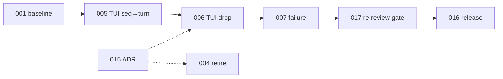

# Ticket dependency graph and agent waves

Coordination view of the RWC backlog. The Mermaid source of truth is
[`dependencies.mmd`](dependencies.mmd); the diagram below is the same graph with
the wave/agent notes that do not belong in the diagram itself.

Use this page to decide **what can start now**, **what must wait**, and **which
tickets must not be edited concurrently**.

## How to read it

- **Solid arrow → hard prerequisite.** The target cannot be marked done before
  the source is done (or at least its contract is stable).
- **Dotted arrow → coordination, not precedence.** The tickets can run in
  parallel, but they touch the same files or share a test/pack step; serialize
  them or put them in one agent lane.
- **Wave** = longest-path level from the three roots (`001`, `008`, `015`).
  Everything in a wave is *eligible* once the previous wave's inputs land; it is
  not automatically safe to parallelize (see the lane table).
- **Colors:** green = open, orange = blocked, blue = decision, purple dashed =
  continuous (starts early, closes late).
- `RWC-013` is marked continuous: it starts in wave 1 and its **close** gate
  waits for the code fixes; its test-acceptance edges are omitted to keep the
  graph readable.

## Diagram

```mermaid
%% rewind-compact ticket dependency graph (2026-10-27, post-review)
%% Solid arrow = hard prerequisite. Dotted arrow = coordination / shared files.
%% Green = open/in-progress, orange = blocked, blue = decision, grey = done.
%% RWC-017 is green: every changed ticket passed independent review + verify.
%% RWC-016 is the remaining release gate.
flowchart TB
  classDef open fill:#E8F5E9,stroke:#2E7D32,color:#1B5E20
  classDef progress fill:#FFFDE7,stroke:#F9A825,color:#795548
  classDef blocked fill:#FFF3E0,stroke:#E65100,color:#BF360C
  classDef decision fill:#E3F2FD,stroke:#1565C0,color:#0D47A1
  classDef continuous fill:#F3E5F5,stroke:#6A1B9A,color:#4A148C,stroke-dasharray: 4 2
  classDef done fill:#ECEFF1,stroke:#607D8B,color:#37474F

  subgraph w0["Wave 0 — done"]
    direction LR
    t001["RWC-001<br/>harness baseline<br/>P0 · done"]:::done
    t008["RWC-008<br/>turn-point validation<br/>P1 · done"]:::done
    t015["RWC-015<br/>spec decisions (ADR)<br/>P0 · done"]:::done
    t014["RWC-014<br/>packaging<br/>P2 · done"]:::done
  end

  subgraph w1["Wave 1 — merged + remediated"]
    direction LR
    t002["RWC-002<br/>fork metadata + JSONL proof<br/>P0 · done"]:::done
    t003["RWC-003<br/>surface seed + policy replay<br/>P0 · done"]:::done
    t004["RWC-004<br/>retire in-place<br/>P0 · done"]:::done
    t005["RWC-005<br/>TUI seq → turn<br/>P0 · done"]:::done
    t006["RWC-006<br/>TUI after + summary<br/>P1 · done"]:::done
    t009["RWC-009<br/>message source<br/>P1 · done"]:::done
    t010["RWC-010<br/>files changed<br/>P1 · done"]:::done
    t012["RWC-012<br/>profiles + sdk-minimal<br/>P1 · done"]:::done
    t013["RWC-013<br/>tests + probe<br/>P1 · done"]:::done
  end

  subgraph w2["Wave 2 — convergence"]
    direction LR
    t007["RWC-007<br/>failure atomicity<br/>P0 · done"]:::done
    t011["RWC-011<br/>docs/spec alignment<br/>P1 · done"]:::done
    t017["RWC-017<br/>review + verify gate<br/>P0 · done"]:::done
  end

  subgraph w3["Wave 3 — release"]
    t018["RWC-018<br/>TUI picker descoped v1<br/>P0 · done"]:::done
    t016["RWC-016<br/>release verification<br/>P1 · done"]:::done
  end

  subgraph w4["Wave 4 — post-release fixes"]
    t019["RWC-019<br/>picker: in-context turns only<br/>P1 · done"]:::done
    t020["RWC-020<br/>tool gate: seq→index mapping<br/>P1 · done"]:::done
  end

  %% hard prerequisites
  t001 --> t002
  t001 --> t003
  t001 --> t004
  t001 --> t005
  t001 --> t010
  t001 --> t012
  t001 --> t013
  t001 --> t014

  t015 --> t004
  t015 --> t006
  t015 --> t011

  t005 --> t006
  t003 --> t009
  t004 --> t007
  t006 --> t007

  t002 --> t011
  t003 --> t011
  t004 --> t011
  t005 --> t011
  t006 --> t011

  t002 --> t017
  t003 --> t017
  t004 --> t017
  t005 --> t017
  t006 --> t017
  t007 --> t017
  t009 --> t017
  t010 --> t017
  t011 --> t017
  t012 --> t017
  t013 --> t017
  t014 --> t017

  t013 --> t016
  t014 --> t016
  t015 --> t018
  t018 --> t016
  t017 --> t016
  t008 --> t019
  t018 --> t019
  t013 --> t020

  %% coordination / shared files (no precedence implied)
  t002 -.->|shared rewind/seed| t003
  t004 -.->|shared tool/scaffold| t010
  t006 -.->|TUI summary input| t010
  t013 -.->|pack/test| t014
  t011 -.->|claim audit| t017
```

## Status after the review gate (2026-10-27)

- **Done:** RWC-001, 002, 003, 004, 005, 006, 007, 008, 009, 010, 011, 012,
  013, 014, 015, 017. Every changed ticket has an independent review PASS and
  an independent verification VERIFIED recorded in its file.
- **Green:** `npm test` 81/81; `npm run check` ALL CONTRACTS PASS, including the
  v4-only fixture gate, real `Session.create` for both modes, replacement and
  policy fixtures, the child-JSONL proof, the summary source/declaration, and
  the direct-human gate tests.
- **Done:** RWC-016 release verification. RWC-018 descoped the TUI Esc-Esc
  picker for v1 (backend bundle vs host DecisionEvents); the TUI command/tool
  ship. Web E2E, packaging, profile, and contract evidence are green.
- **Open (post-release):** none — RWC-019 (picker lists only in-context
  turns) and RWC-020 (tool gate seq→index mapping), both filed from live use
  on 2026-10-27, are done: each merged into `main` only after an independent
  code review (approve) and an independent acceptance check (pass).

## Agent queue (release)

| Agent lane | Ticket | State |
|---|---|---|
| **main / release** | RWC-016 | in-progress (final evidence) |
| **decision** | RWC-018 | done: TUI picker descoped v1 |
| **review/verify** | closed (RWC-017 done) | — |

## Completed lanes

| Lane | Tickets | Outcome |
|---|---|---|
| **A — fork/seed** | 002, 003, 009 | done, reviewed, verified |
| **B — TUI/tool** | 004, 005, 006, 007, 010 | done, reviewed, verified |
| **C — tests/probe** | 013 + 017 gate | done, reviewed, verified |
| **D — profiles** | 012 | done, reviewed, verified |
| **E — docs** | 011 (SPEC / README+SKILL+TESTING / AGENTS+HARNESS) | done, reviewed, verified |
| **F — release** | 016 | in progress (only open lane) |

## Critical path and risks

Hard longest chain:

Text: `001 → 005 → 006 → 007 → 017 → 016`, with `015` feeding `004`/`006`.

- **RWC-016 is the only remaining risk.** It must exercise scratch profiles
  and the live surfaces without touching the live profile/TUI. The web E2E and
  interactive TUI run are the expensive parts; the automated gates are green.
- RWC-007 was the integration point and is closed.
- RWC-013 closed after the direct-human gate tests were added.
- RWC-011 is closed; docs and SPEC agree on scaffold-only v1, retired in-place,
  after-only TUI, no prompt, and title-in-`setup`.

## Shared-file rules (avoid concurrent edits)

| Surface | Tickets | Rule |
|---|---|---|
| `lib/rewind.js`, `lib/seed.js` | `002`, `003`, `009` | Lane A only; order `002 → 003 → 009`. |
| `lib/tool.js`, `lib/scaffold.js`, `lib/events.js` | `004`, `007`, `008`, `010` | `008` before `010`; `004`/`010` one lane; `007` after `004`. |
| `lib/tui-rewind.js` | `005`, `006`, `007` | Lane C only; order `005 → 006 → 007`. |
| `lib/index.js` | `012` | Lane D; coordinate with any entry export changes from A. |
| `scripts/check-contracts.mjs` | `001`, `013` | `001` establishes the baseline; `013` hardens it after. |
| `tests/` | all fixes + `013` | Fix agents add regression tests in their module’s test file; `013` owns fixtures, probe, and E2E. Do not bulk-edit the same test file concurrently. |
| `package.json`, `README.md`, `SKILL.md`, `TESTING.md`, `AGENTS.md` | `001`, `011`, `014`, `016` | `014` is done. `011` may run in parallel only as disjoint slices (SPEC / README+SKILL+TESTING / AGENTS+HARNESS); `016` runs after `017`. |
| `docs/tickets/` | every ticket | Each agent updates only its ticket + its board row. Bulk edits go through the release owner; the board/graph are owned by the integration lane. |

## Status protocol for agents

1. **Claim:** move the ticket to `in-progress`, set `Owner`, and confirm every
   `Depends on` ticket is `done` (or explicitly waived in the ticket).
2. **Blocked:** do not guess a decision. Comment on the blocking ticket and
   leave the ticket `blocked`; update the graph so no agent starts it.
3. **Red first:** for a bug fix, add a failing regression test before the fix;
   record the red state in the ticket.
4. **Done:** check every acceptance box, run the verification commands, attach
   the output/evidence to the ticket, and update the board row.
5. **Conflict:** if two lanes need the same file, the later lane rebases after
   the earlier one lands and re-runs its tests. Do not resolve by silent
   overwrite.
6. **Release:** `016` only after every P0/P1 ticket is `done` and `013` is
   green on the declared harness line.

## Updating this graph

When a ticket’s `Depends on`/`Blocks` changes:

1. Update the ticket and its board row.
2. Update [`dependencies.mmd`](dependencies.mmd) and the diagram in this file
   (keep them identical).
3. Recompute waves if a hard edge changed; update the lane table if ownership
   boundaries moved.
