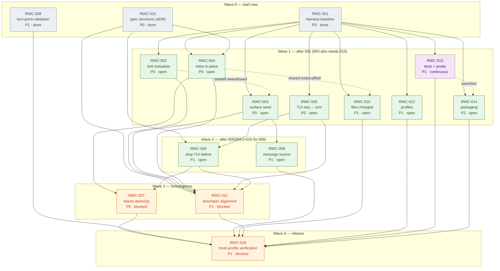
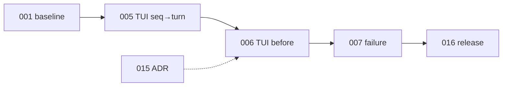

# Ticket dependency graph and agent waves

Coordination view of the RWC backlog. The Mermaid source of truth is
[`dependencies.mmd`](dependencies.mmd); the diagram below is the same graph with
the wave/agent notes that do not belong in the diagram itself.

Use this page to decide **what can start now**, **what must wait**, and **which
tickets must not be edited concurrently**.

## How to read it

- **Solid arrow → hard prerequisite.** The target cannot be marked done before
  the source is done (or at least its contract is stable).
- **Dotted arrow → coordination, not precedence.** The tickets can run in
  parallel, but they touch the same files or share a test/pack step; serialize
  them or put them in one agent lane.
- **Wave** = longest-path level from the three roots (`001`, `008`, `015`).
  Everything in a wave is *eligible* once the previous wave's inputs land; it is
  not automatically safe to parallelize (see the lane table).
- **Colors:** green = open, orange = blocked, blue = decision, purple dashed =
  continuous (starts early, closes late).
- `RWC-013` is marked continuous: it starts in wave 1 and its **close** gate
  waits for the code fixes; its test-acceptance edges are omitted to keep the
  graph readable.

## Diagram

## Status after wave 0 (2026-10-27)

- **Done:** `RWC-001` (harness baseline) and `RWC-008` (fail-closed turn
  points), each implemented, independently reviewed, and independently
  verified. `npm run check` is green with three documented deviations
  (legacy fork options → RWC-002, legacy summary source → RWC-009, seed
  flattening → RWC-003).
- **Signed off:** `RWC-015` — ADR accepted 2026-10-27; `004` and `006` are
  open, `011` waits on the code fixes.
- **Ready next:** `002`, `004`, `005`, `006`, `010`, `012`, `013`, `014`;
  `003` starts after `002`, and `009` after `003`.
- **Still blocked:** `007` (004 + 006), `011` (code fixes), `016` (release).

The original wave-0 plan is closed; use the lane table below for the next
assignment.

## Wave and lane plan

Suggested lanes, not a requirement. A lane is one agent/context; tickets in a
lane are sequential.

| Lane | Tickets (order) | Owns | Notes |
|---|---|---|---|
| **A — fork** | `002 → 003 → 009` | `lib/rewind.js`, `lib/seed.js`, seed tests | `002`/`003` share files; `009` is the last seed change. |
| **B — tool/compaction** | `010 → 004 → support 007` (or `004 → 010` once `015` lands) | `lib/tool.js`, `lib/scaffold.js`, `lib/events.js` | `008` must land before `010` edits `events.js`. `004` starts only after the ADR. |
| **C — TUI** | `005 → 006 → support 007` | `lib/tui-rewind.js` | `006` needs `015`; keep `005`/`006` serial. |
| **D — profiles** | `012` | `lib/index.js` | Independent; verify web/TUI/sdk-minimal. |
| **E — tests/probe** | `013` (continuous) | `scripts/check-contracts.mjs`, fixtures, E2E | Starts with failing regression tests; closes after A–D/B/C land. Fix agents add their own module tests. |
| **F — package/docs/release** | `014 → 011 → 016` | `package.json`, `README.md`, `SKILL.md`, `TESTING.md`, `AGENTS.md` | `001` first touches package/contracts; `011` after behavior settles, folding in `007` error text, `010` field wording, and `012` profile matrix; `016` last. |
| **G — decision** | `015` + review of `004`/`006`/`011` | `docs/decisions/`, `SPEC.md` | Not an implementation lane; owner sign-off required. |

Wave 1 can run **six lanes** (A–F) if `015` has landed for lane B; otherwise
lane B starts with `010` and waits for `015` before `004`. Wave 2 has two lanes
(A: `009`, C: `006`). Wave 3 has two lanes (B/C integration for `007`, F for
`011`). Wave 4 is one lane (F/release for `016`).

## Critical path and risks

Hard longest chain:

Text: `001 → 005 → 006 → 007 → 016`, with `015` feeding `006` (and `004`).

- **RWC-015 is the schedule risk.** It does not appear in the longest hard
  chain only because `005` can proceed without it, but `006` (and `004`) cannot.
  A late ADR pushes wave 2/3 and therefore `016`.
- **RWC-007 is the integration point.** It needs both the in-place path (`004`)
  and the TUI path (`006`); if either slips, `007` slips.
- **RWC-013 closes late.** It starts in wave 1, but its acceptance gate waits
  for the fixes; `016` must not start until `013` is green.
- **RWC-011 is the docs tail.** It must follow the behavior changes; do not let
  it race `014` on `README.md`.
- The fork path (`002 → 003 → 009`) and release path (`013 → 014 → 016`) are
  shorter, so they can absorb some slack — but `003`/`009` feed `013`’s fixtures.

## Shared-file rules (avoid concurrent edits)

| Surface | Tickets | Rule |
|---|---|---|
| `lib/rewind.js`, `lib/seed.js` | `002`, `003`, `009` | Lane A only; order `002 → 003 → 009`. |
| `lib/tool.js`, `lib/scaffold.js`, `lib/events.js` | `004`, `007`, `008`, `010` | `008` before `010`; `004`/`010` one lane; `007` after `004`. |
| `lib/tui-rewind.js` | `005`, `006`, `007` | Lane C only; order `005 → 006 → 007`. |
| `lib/index.js` | `012` | Lane D; coordinate with any entry export changes from A. |
| `scripts/check-contracts.mjs` | `001`, `013` | `001` establishes the baseline; `013` hardens it after. |
| `tests/` | all fixes + `013` | Fix agents add regression tests in their module’s test file; `013` owns fixtures, probe, and E2E. Do not bulk-edit the same test file concurrently. |
| `package.json`, `README.md`, `SKILL.md`, `TESTING.md`, `AGENTS.md` | `001`, `011`, `014`, `016` | Serialize: `001` baseline → `014` package → `011` docs → `016` evidence. |
| `docs/tickets/` | every ticket | Each agent updates only its ticket + its board row. Bulk edits go through the release owner. |

## Status protocol for agents

1. **Claim:** move the ticket to `in-progress`, set `Owner`, and confirm every
   `Depends on` ticket is `done` (or explicitly waived in the ticket).
2. **Blocked:** do not guess a decision. Comment on the blocking ticket
   (`015` for `004`/`006`/`011`) and leave the ticket `blocked`.
3. **Red first:** for a bug fix, add a failing regression test before the fix;
   record the red state in the ticket.
4. **Done:** check every acceptance box, run the verification commands, attach
   the output/evidence to the ticket, and update the board row.
5. **Conflict:** if two lanes need the same file, the later lane rebases after
   the earlier one lands and re-runs its tests. Do not resolve by silent
   overwrite.
6. **Release:** `016` only after every P0/P1 ticket is `done` and `013` is
   green on the declared harness line.

## Updating this graph

When a ticket’s `Depends on`/`Blocks` changes:

1. Update the ticket and its board row.
2. Update [`dependencies.mmd`](dependencies.mmd) and the diagram in this file
   (keep them identical).
3. Recompute waves if a hard edge changed; update the lane table if ownership
   boundaries moved.
